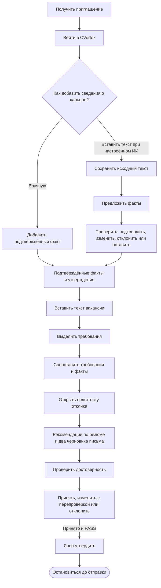
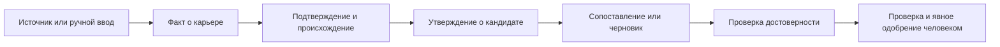
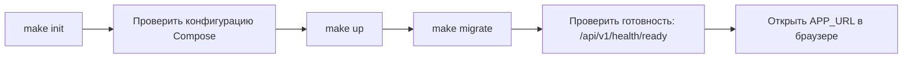
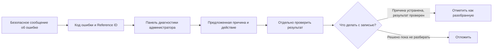

# Карта процессов CVortex

Здесь собраны ключевые маршруты данных и сценарии работы с CVortex в текущей предварительной версии. Модули M1.1, M1.2 и M1.3 уже в строю, а M1.4 стабилизируется в ветке `stage`. Полноценное тестирование Preview 0.1 с реальными пользователями ещё впереди.

Чтобы нарезать факты из текста, разобрать вакансию и собрать черновики откликов, оператор подключает сервис ИИ. Но строгой зависимости нет: факты о карьере всегда можно завести руками. Требования вакансии сопоставляются с карьерным опытом по прозрачным детерминированным правилам. Ссылку на вакансию система держит только для порядка — парсить веб-страницы по внешним адресам CVortex пока не обучен.

## Пользовательский путь в Preview 0.1

Добавить карьерный багаж можно двумя путями: вбить факт вручную либо вставить сырой текст резюме. Во втором случае CVortex пропустит его через модель и выдаст список фактов на верификацию: их можно подтвердить, подправить, отклонить или временно отложить. Дальше вставляем описание вакансии: система выделит ключевые требования, сопоставит их с проверенными фактами и откроет экран подготовки отклика с двумя вариантами сопроводительного письма и советами по резюме. Нажатие «Утвердить» фиксирует выбор внутри CVortex — никаких тайных отправок работодателю не происходит.

Автоматический контроль достоверности безжалостно отсекает галлюцинации и неподтверждённые тезисы. Если вы правите сгенерированный текст, проверка запускается заново. Одобренный черновик сохраняется в базе CVortex — выгрузка в PDF/DOCX и отправка откликов появятся в следующих версиях.

## Происхождение данных: почему фактам можно доверять

Сырой текст резюме — лишь отправная точка, а не доказанный факт. Ручной ввод сразу получает статус подтверждённого источника. Факты, предложенные нейросетью, считаются неподтверждёнными до тех пор, пока человек явно не нажмёт кнопку одобрения. Утверждение (claim) о кандидате попадает в анализ вакансии и черновики писем только тогда, когда оно намертво привязано к подтверждённому факту из проверенного источника.

Неразрывная цепочка от исходного текста к утверждению хранится в системе для аудита. Неподтверждённые догадки модели в боевые материалы кандидата не попадут.

## Локальный запуск на машине разработчика

Для старта в чистом репозитории оператор готовит переменные окружения, валидирует Compose-манифест, поднимает стек и накатывает миграции. Открывать веб-интерфейс стоит только после того, как эндпоинт готовности отдаст зелёный статус.

Полный список команд и рецепты решения проблем собраны в руководстве [«Локальная установка и запуск»](../10-Operations/Local-Development.md). Порт Nginx определяется через Compose. Важный нюанс: PostgreSQL может рапортовать о здоровье контейнера, но само приложение не заведётся, если в существующем Docker-томе отсутствует база, указанная в `POSTGRES_DB`. При любых нестыковках сверяйте переменные окружения, не спешите удалять тома.

## Разбор инцидентов и диагностика

Когда что-то идёт не так, CVortex отдаёт безопасную ошибку с кодом и `Reference ID`. По этому идентификатору администратор моментально находит запись в центре диагностики. На панели отображаются симптомы, стек вызовов и рекомендуемые шаги. Прежде чем перевести инцидент в статус решённого или отложенного, оператор обязательно проверяет реальное состояние системы. Диагностика подсказывает направление поиска, но не подменяет собой ручную проверку данных.

При общении с поддержкой или передаче тикета достаточно назвать код и `Reference ID`. Никаких паролей, API-ключей или конфиденциальных текстов резюме передавать не нужно. Подробные инструкции для пользователя и администратора описаны в [руководстве по разбору ошибок](Error-Center-User-Guide.md).

## Горизонт планирования: M2 и далее

Этап M2 стартует сразу после завершения приёмки Preview 0.1. В планах: экспорт откликов в DOCX и PDF, версионирование резюме, защищённое скачивание архивов и ручная фиксация факта отправки («Отклик отправлен»). Автоматических спам-рассылок откликов работодателям CVortex не делает и делать не будет.

Детальный план развития со всеми майлстоунами зафиксирован в [Roadmap](../01-Product/Roadmap.md). Наличие фичи в роадмапе показывает вектор движения, но не означает её сиюминутную доступность.
