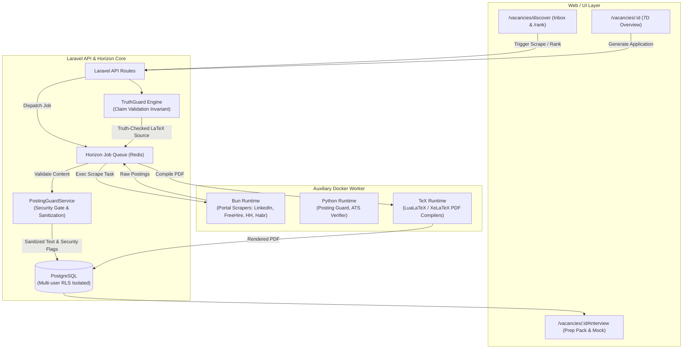

# ADR-0028 — AI Job Search Integration: Dedicated Auxiliary Worker, Security Guard, and 3-Stage Truth-First Pipeline

## Context

CVortex is designed as a personal Job Search OS centered on the **Truth-First** invariant (`Generated Content → Claims → confirmed Career Facts`), multi-user isolation, and API-first architecture. 

To enhance sourcing, evaluation, generation, and interview preparation, we investigated the open-source **ai-job-search** framework (66k+ stars, `ai-job-search-dev/ai-job-search`), which implements:
1. Multi-portal automated job scraping (LinkedIn, FreeHire 50+ ATS platforms, regional portals) built on TypeScript and Bun.
2. Deterministic posting security checks (`posting_guard.py`) detecting hidden HTML, zero-width steganography, Unicode tag injections, look-alike script spoofing, and prompt injection attacks.
3. A 2-agent Drafter-Reviewer refinement loop for application tailoring.
4. ATS-optimized document generation using LaTeX (`lualatex` / `xelatex`) alongside ATS parsability verification.
5. Structured interview preparation (`/interview`), STAR-framework talking points, gap bridging, and stage-specific mock simulation.

Directly executing Bun, Python, and LaTeX inside CVortex's PHP-FPM container would violate container immutability, bloat production images, and risk worker thread starvation. Furthermore, unconstrained AI tailoring from external prompts risks violating CVortex's fundamental **Truth-First** invariant by inventing unconfirmed candidate claims.

## Decision

We adopt a comprehensive, modular integration of `ai-job-search` capabilities across four architectural pillars:

### 1. Dedicated Auxiliary Worker Container (`worker`)
Add an auxiliary headless worker service to `compose.yaml` encapsulating:
- **Bun & Node.js**: for executing portable portal search CLI skills (`.agents/skills/*/cli/`).
- **Python 3.11**: for deterministic page decoding, security guard validation (`posting_guard.py`), and ATS parsing checks (`pypdf`).
- **Minimal TeX Environment**: LuaLaTeX and XeLaTeX toolchains for premium typesetting of CVs and cover letters.

The worker is completely decoupled from web traffic and communicates exclusively through **Laravel Horizon & Redis queues** and command dispatchers.

### 2. In-line Ingestion Security Gate (`PostingGuard`)
Every imported or scraped job posting must pass through `PostingGuardService` prior to database persistence and LLM prompt construction:
- **Hidden Element Stripping**: Removes CSS-hidden blocks (`display:none`, `visibility:hidden`, `opacity:0`, `font-size:0`, `color:transparent`, `clip`, `text-indent: -9999px`, zero-size overflow hidden).
- **Steganography Removal**: Strips zero-width characters (`ZERO_WIDTH`), Bidi overrides (`BIDI_TAMPER`), and Unicode tag characters (U+E0000–U+E007F) used to hide malicious instructions from human readers.
- **Prompt Injection & Scam Detection**: Flags instruction-shaped lines (`ignore previous instructions`, `you are an ai`, `system prompt`) and scam patterns.
- **Threat Isolation**: Flagged postings receive a `SUSPICIOUS_CONTENT` / `SECURITY_WARNING` audit badge in the UI and are sanitized before being interpolated into AI context windows.

### 3. Three-Stage Truth-First Drafting Loop (Drafter → Reviewer → Truth Guard)
To combine the recruiter/ATS critique of `ai-job-search` with CVortex's Truth-First constraint, application generation follows a strict three-stage pipeline:
1. **Drafter Agent**: Generates the application draft (CV and cover letter) tailored to the vacancy requirements, restricted strictly to confirmed `Career Facts` and pre-approved claims.
2. **Reviewer Agent** (from `ai-job-search`): Critiques style, tone, STAR metrics, and keyword alignment from the perspective of an ATS and senior hiring manager.
3. **Truth Guard** (CVortex invariant): Intercepts the reviewer's suggested revisions to ensure no hallucinated claims, inflated metrics, or unconfirmed experiences are introduced into the final draft.

### 4. Hybrid Document Generation Pipeline
We retain CVortex's approved DOCX + LibreOffice headless PDF pipeline (ADR-0016) for editable document workflows, while introducing the worker's LaTeX compiler as an alternative output engine for candidates seeking high-typography, ATS-parseable LaTeX PDF layouts.

### 5. Interview Preparation & Outcome Hub
Implement a dedicated **Interview Workspace** (`/vacancies/:id#interview`) incorporating:
- Automated **Prep Pack**: STAR behavioral stories mapped to vacancy criteria, gap-bridging arguments, company research dossier, and intelligent interviewer questions.
- Interactive **Mock Interview Simulator**: conversational roleplay chat evaluating the candidate's responses against vacancy requirements and career facts.
- **Stage & Outcome Tracker**: lifecycle tracking from application submission to phone screen, technical interview, final round, and offer/rejection feedback retention.

## Phasing & Delivery Roadmap

Implementation is executed in four sequential phases:
- **Phase 1: Worker Infrastructure & Posting Guard Security Gate** (compose service, `PostingGuardService`, unit & integration tests).
- **Phase 2: Portal Scrapers & Discover/Inbox Workspace** (LinkedIn, FreeHire, HH/Habr adapters, `/vacancies/discover`, `/rank`).
- **Phase 3: Three-Stage Drafter-Reviewer & Hybrid LaTeX Engine** (Drafter, Reviewer, Truth Guard gate, LuaLaTeX/XeLaTeX generation).
- **Phase 4: Interview Workspace & Mock Simulation** (Prep Pack generation, STAR stories, interactive mock chat, outcome tracker).

## Consequences

### Positive
- **Deterministic Protection**: Eliminates prompt injection and steganographic attacks in job postings before LLM evaluation.
- **Separation of Concerns**: Non-PHP runtimes (Bun, Python, TeX) are isolated in a background worker container, preserving PHP-FPM stability and speed.
- **Preserved Truth Invariant**: The 3-stage loop allows aggressive ATS and stylistic optimization without compromising candidate factual integrity.
- **Expanded Sourcing**: Enables automated discovery across international (LinkedIn, FreeHire) and local platforms.
- **End-to-End Application Lifecycle**: Extends CVortex from application drafting into interview preparation and outcome management.

### Negative / Trade-offs
- Docker Compose resource footprint increases due to the auxiliary worker image (Python, Bun, TeX packages).
- Requires maintenance of portal scraping adapters against third-party UI/API changes.