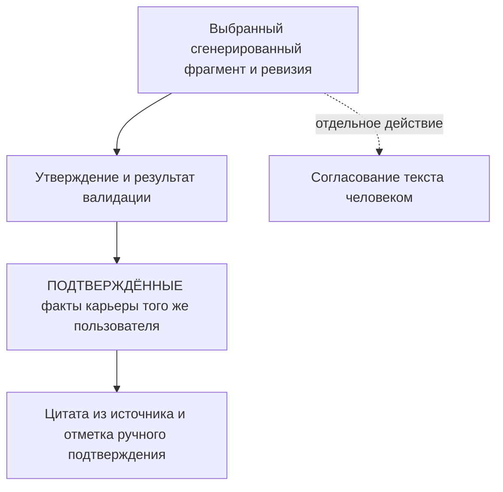

# Рабочая область отклика (Application Workspace)

## Направление и границы реализации

**Концепция B / Рабочая область отклика (Application Workspace)** — утверждённое ключевое направление интерфейса CVortex. В центре рабочего контекста пользователя находится конкретная вакансия со всеми принятыми решениями, подтверждениями фактов, черновиками материалов и контекстом работодателя. Этот документ задаёт **целевой контракт взаимодействия**, а не заявляет, что все описанные экраны уже полностью выведены в продакшн. Размеры в пикселях и демонстрационные статусы в [прототипе концепции B](../../research/design-redesign/concept-b/index.html) носят поисковый характер.

Цвета бренда, примитивы, семантические состояния и правила доступности определены в [Основах дизайна](Design-Foundation.md). В документе [Согласование дизайна](Concept-B-Reconciliation.md) зафиксированы различия, подтверждения тестов и зависимости реализации. Текущий документ добавляет продуктовые паттерны в существующую систему, а не создаёт вторую дизайн-систему.

## Каноническая глобальная информационная архитектура

| Раздел | Назначение | Контекст и текущие границы реализации |
| --- | --- | --- |
| **Сегодня (Today)** | Компактная сводка задач и входящих действий с быстрыми переходами в рабочую область | Только реальные задачи, требующие проверки, устаревшие анализы или действия, созданные пользователем. Никакой искусственной срочности, фейковых счётчиков или придуманных интервью. На старте строится как проекция данных из Карьеры, Вакансий и черновиков. |
| **Возможности (Opportunities)** | Сохранённые вакансии до и после создания отклика: список → выбранная рабочая область | Текущая вакансия, требования, детерминированное соответствие, сохранённая подготовка и черновики. Полный жизненный цикл отклика ждёт реализации своего доменного среза. Это основное рабочее пространство пользователя. |
| **Карьера (Career)** | Каноническая база подтверждённых фактов пользователя (Fact Base), черновики на проверке, утверждения и подтверждающие документы | Текущее ручное ревью фактов из вставленного текста; будущие разделы треков и файлов подключаются только после реализации. При переходе в Карьеру из конкретной вакансии возврат назад восстанавливает контекст этой вакансии. |
| **Работодатели (Employers)** | Сквозная история взаимодействия с конкретным работодателем по всем вакансиям | Интерфейсное название для сущности «Компания» (Company) и приватного контекста работодателя, а не переименованная таблица в базе данных. Требует независимо подтверждённой связи с компанией и модели с изоляцией по владельцу; на старте показывает понятную плашку недоступности без выдуманных историй. |
| **Настройки (Settings)** | Учётная запись, параметры подключения ИИ и системные настройки | Только реально поддерживаемые элементы управления. Доступная только администраторам «Диагностика» размещается здесь как служебный пункт, сохраняя эндпоинт `/diagnostics` и проверку серверных прав; она не является шестым продуктовым разделом. |

Почему именно пять разделов: Карьера хранит переиспользуемую правду о кандидате; Возможности содержат работу по конкретным вакансиям; Работодатели отвечают за согласованность истории взаимодействия с компаниями; Настройки управляют параметрами системы; Сегодня показывает, что требует внимания прямо сейчас, и даёт быстрые ссылки на остальные четыре раздела. Документы и исследования — это артефакты и контекст, а не отдельные разделы верхнего уровня. Попытка сделать пошаговый мастер из семи шагов ошибочно превратила бы нелинейную работу над откликом в принудительный конвейер.

**Документы** живут внутри контекста резюме, сопроводительного письма и материалов с точным указанием версии и статуса согласования. Будущую общую библиотеку файлов можно будет открыть из Карьеры (для переиспользуемых материалов) или из Возможностей (для подготовленных откликов) с фильтрацией по владельцу; сейчас такой библиотеки в коде нет. Формирование файлов DOCX и PDF регулируется решением ADR-0016 и задачами этапа M2.

**Исследования** располагаются в контексте работодателя (информация о компании), в разделе требований и соответствия (внешние требования рынка) и в Карьере (актуальные правила найма). У каждого источника сохраняются дата, URL, цепочка происхождения и свежесть; внешние исследования ни при каких условиях не могут заменить подтверждённые факты биографии кандидата при обосновании утверждений.

## Вакансия ↔ Возможность ↔ Отклик

| Понятие | Контракт сущности |
| --- | --- |
| Вакансия (Vacancy) | Существующая вакансия пользователя с неизменяемыми снимками исходного текста, требованиями и анализом. Может существовать без отклика. |
| Возможность (Opportunity) | Контекст интерфейса, объединяющий вакансию и подготовку отклика к ней. Отдельная таблица `Opportunity`, ресурс API или новый конечный автомат не создаются. |
| Подготовка отклика (ApplicationPreparation) | Текущий агрегат сохранённого черновика и материалов, прикреплённый к вакансии. Не является доказательством того, что отклик уже отправлен работодателю. |
| Отклик (Application) | Концептуальная сущность пользователя из Фазы 06 / M2, связывающая вакансию, подтверждённую компанию, точные версии материалов и историю взаимодействия. В кодовой базе пока не реализована. |

Концептуальное соотношение «одна вакансия — несколько откликов» сохраняется на будущее. Если к вакансии позже будет привязано несколько откликов, появится селектор версий; их согласования и переписка никогда не смешиваются. До этого момента в шапке пишется честное **Вакансия / подготовка**, а не фиктивный статус отправленного отклика. Название компании из текста вакансии считается непроверенным и не может служить ключом для объединения с приватной Памятью о работодателе.

## Анатомия рабочей области и навигация

Компоновка для десктопа: глобальная навигация + список возможностей + основная рабочая область задачи + опциональный контекстный инспектор. Комфортная ширина рабочей зоны важнее постоянной видимости всех колонок сразу. Фиксированная ширина колонок из прототипа не переносится в дизайн-токены.

В шапке всегда выводятся: должность, наличие названия компании, статус (подготовка или отправленный отклик), доменный статус и следующее безопасное действие человека с указанием причин блокировки, если они есть. Диапазон зарплаты, валюта, период и формат работы выводятся компактной второй строкой, если они известны; неизвестные параметры прямо помечаются как неизвестные. Приоритет является вторичной пользовательской отметкой. Никаких додуманных данных из фикстур или фальшивых «процентов заполненности».

Чётко разделяются: **статус анализа**, **класс рекомендации**, **статус проверки/согласования черновика**, **жизненный цикл отклика**, **приоритет** и **следующее действие**. Кнопка «Подать отклик» (APPLY) означает поддержку принятия решения, а не автоматическую отправку резюме работодателю. Статусы «Подготовка / Переписка / Интервью» из прототипа являются демонстрацией, а не утверждёнными полями базы данных. Применяются только реальные значения перечислений из API, а неизвестные значения безопасно отображаются в интерфейсе.

Внутри рабочей области используются **локальные ссылки на подразделы** с подсветкой активного экрана и поддержкой прямых ссылок. Это не виджет вкладок ARIA, притворяющийся ссылками, а полноценная постраничная навигация. На десктопе ссылки располагаются в строку; на компактных экранах сворачиваются в меню подразделов с понятными подписями. Переключение между подразделами не сбрасывает выбранную вакансию и не уничтожает несохранённый текст ревью.

| Основной подраздел | Содержание и вторичная навигация | Доступность |
| --- | --- | --- |
| **Обзор (Overview)** | Следующее действие, явные блокеры, краткая сводка соответствия/пробелов/рисков, готовность материалов и недавняя активность | Сводки строятся строго на основе доступных данных; никакой выдуманной «готовности». |
| **Требования и соответствие (Requirements & Match)** | Требования и точные цитаты из источника; 7 критериев оценки; пробелы, неизвестные параметры и риски; исходный текст вакансии | Контракт текущего анализа вакансий. Локальные фильтры и якоря вместо двух конкурирующих глобальных страниц. |
| **Материалы (Materials)** | Переключение: **Резюме / Сопроводительное письмо**; рекомендации, визуальный дифф, точная ревизия, подтверждения фактов и согласование; экспорт файлов появится позже | Текущие черновики рекомендаций и писем. Честные названия: без заявлений о наличии готового экспорта цельного документа резюме. |
| **Контекст работодателя (Employer context)** | Информация о компании, подтверждённые обязательства и история; переписка и интервью появятся позже | Отложенные функции честно отображаются как недоступные. Встроенный чат анализа вакансии — это аналитический инструмент, а не переписка с рекрутером. |
| **История (History)** | Доступные ревизии источника, анализа и черновиков с решениями; история отклика, диалогов и интервью появится позже | Только реально зафиксированные события. История изменений не заменяет цепочку подтверждения фактов. |

Недоступные подразделы скрываются или снабжаются понятным объяснением, почему функция пока не работает и что требуется для её включения. На этапе постепенного развёртывания глобальные разделы могут показывать заглушки с описанием статуса разработки. Запрещено заполнять будущие экраны фальшивыми «живыми» демо-записями.

Выбор вакансии сохраняет поисковый запрос, фильтры, позицию прокрутки и активный подраздел. Кнопки браузера «Назад»/«Вперёд» и прямые ссылки возвращают в то же самое состояние. Если выбранная запись перестаёт попадать под условия фильтра, показывается уведомление или происходит возврат к списку; тихих переключений быть не должно. Запросы данных, ответы от бэкенда и содержимое инспектора строго изолированы рамками выбранного владельца, вакансии и ревизии; задержавшийся сетевой ответ не может перезаписать данные другой вакансии. При наличии несохранённых правок перед уходом с экрана выводится диалог «Остаться / Сбросить изменения». Конкретная структура URL утверждается в рамках задачи на шелл приложения.

## Контекстный инспектор

Инспектор — это специальная вспомогательная панель для **выбранного требования, критерия оценки, утверждения, рекомендации или обязательства работодателя**. На широких экранах при клике на подтверждение или причину инспектор открывается рядом с основной рабочей зоной. Если ничего не выбрано, инспектор закрыт. Причина блокировки всегда остаётся видна по месту (inline), даже если инспектор закрыт.

В инспекторе отображаются: название, тип и статус элемента, источник и ревизия, почему элемент важен, краткие цитаты подтверждений и ссылки на полный источник. Цепочка подтверждений фактов наглядно показывает путь: фрагмент текста и ревизия → Утверждение о кандидате → ПОДТВЕРЖДЁННЫЙ факт биографии того же пользователя → цитата из первоисточника и метаданные ручного подтверждения человеком. Автор и время действия в аудит-логе отделены от подтверждения истинности факта. Текст вакансии и сообщения рекрутеров помечаются как непроверенные и выводятся как обычный текст без исполнения HTML.

Клик по элементу обновляет содержимое незакреплённого инспектора. Кнопка **Закрепить (Pin)** оставляет элемент открытым при переходе по основной задаче внутри той же вакансии; при этом показывается плашка закреплённого элемента и отметка об устаревании, если контекст изменился. Закрепление — это состояние сессии интерфейса, а не заморозка старых данных в базе. Переключение на другую вакансию сбрасывает выбор и закрепление, полностью очищая контекст перед загрузкой новых данных. Кнопка **Закрыть** сворачивает инспектор и возвращает фокус клавиатуры на элемент вызова; кнопка **Открепить** возвращает инспектор в режим следования за текущим выбором. Инспектор никогда не открывается от простого наведения курсора мыши.

Контекст работодателя выводится только при наличии подтверждённой связи с компанией того же пользователя и доступных данных. Если связи нет, пишется: **Контекст работодателя недоступен — подтвердите связь с компанией**. Склеивать данные только по текстовому совпадению названия запрещено.

На экранах средней ширины инспектор превращается в выдвижную шторку (drawer) с управлением фокусом. На мобильных устройствах используется отдельный полноэкранный уровень **Контекст / Подтверждения**: длинный текст подтверждений требует нормальной ширины для чтения, а не крошечного всплывающего окна. Короткие всплывающие подсказки не должны содержать кнопок согласования или снятия блокировок.

## Ревью рекомендаций ИИ

Канонический порядок отображения: **Рекомендация → Причина → Подтверждение (источник) → Риск → До / После → Принять / Редактировать / Отклонить**. Карточка предложения располагается непосредственно рядом с изменяемым требованием или текстом черновика, а не прячется на отдельной странице чат-бота. Краткая сводка подтверждений предшествует визуальному диффу; раскрытие полной цепочки опционально. Информацию о рисках или блокировках нельзя скрывать за спойлерами.

Действие «Принять» прикрепляет проверенную точную формулировку к черновику отклика; оно не подтверждает факт биографии, не утверждает весь документ целиком и не регистрирует отправку отклика. Действие «Редактировать» создаёт или обновляет неутверждённую ревизию и повторно проверяет её по актуальным фактам. Действие «Отклонить» сохраняет отметку об отклонении и не совершает лишних вызовов к ИИ-провайдеру. Отдельная кнопка **Согласовать контент** фиксирует текущую точную ревизию, статус валидации и осознанное решение пользователя. Любое редактирование или изменение зависимых данных аннулирует предыдущее согласование; отрисовка зелёного бейджика в UI не даёт права считать контент согласованным в обход проверок бэкенда.

Метрики уверенности должны иметь понятное описание границ и источников. Текущая оценка уверенности извлечения данных нейросетью — это некалиброванный вероятностный сигнал модели: в интерфейсе пишется пояснение вида **Извлечено ИИ — сверьтесь с первоисточником**, а точные числа выводятся только тогда, когда для них есть задокументированная практическая интерпретация. Результат детерминированного сопоставления — это соответствие правилам, а не вероятность успеха. Никаких общих процентов «совместимости с ATS», индикаторов субъективной уверенности и фальшивых агрегированных баллов.

| Состояние анализа / ревью | Требования к интерфейсу |
| --- | --- |
| Не анализировалось / пусто | Исходный текст сохранён; явно указано отсутствие анализа или подтверждений. Кнопка «Анализировать» активна только при наличии прав и настроенной конфигурации. Никаких выдуманных совпадений. |
| Идёт анализ / загрузка | Указана операция и выбранная вакансия; отображается понятный статус; контекст остаётся доступным для чтения. Блокируются только небезопасные повторные вызовы к провайдерам. Никакого нарисованного прогресс-бара. Отмена операции только при поддержке сервером. |
| Ошибка | Суть проблемы → понятная причина (или пометка «причина неизвестна») → влияние на результат → безопасное следующее действие; сохранённые данные не теряются. Безопасный код ошибки без сырых трейсов и скрытых промптов. |
| Устаревшие данные | Видимая причина (изменился исходник или подтверждение факта), время анализа и кнопка повторного запуска; устаревший контент не может служить основанием для утверждения. Старый текст помечается плашкой «устарело». |
| Повторный анализ | Запускается только явным действием пользователя, с предпросмотром передаваемого контекста при необходимости; только через настроенный маршрут без скрытых платных шлюзов. Строгое соблюдение пауз `Retry-After` и изоляции пользователей. |
| Ошибка валидации черновика | Введённый текст сохраняется; показываются поле, причина ошибки и способ исправления. Кнопки «всё равно применить» при отсутствии подтверждённых фактов не существует. |

Полноэкранная ошибка из прототипа лишь иллюстрировала состояние сбоя. В реальном приложении ошибки выводятся локально по месту выполнения операции. Кнопка «Повторить» повторяет только упавшую операцию, не перезапуская остальной анализ. Сохраняется регламент задержек Центра ошибок: операции генерации, редактирования и согласования блокируются на время задержки от провайдера; отклонение черновика без вызова провайдера остаётся доступным всегда.

## Постепенное раскрытие подтверждений (Truth-first)

В обычном состоянии для блока текста отображаются: плашка **Предложение ИИ / неутверждённый черновик**, ссылка на подтверждение факта, статус согласования и плашка блокировки при наличии нарушений. Запрещено красить весь сгенерированный абзац в зелёный цвет со статусом `ПОДТВЕРЖДЕНО`: этот статус относится исключительно к фактам биографии кандидата; утверждения имеют свои результаты валидации, а итоговый текст — собственный статус согласования человеком.

| Условие | Отображение в интерфейсе и разрешённые действия |
| --- | --- |
| Просмотр подтверждений | Цепочка выбранного фрагмента в инспекторе; точные цитаты, ревизия и метаданные подтверждения человеком. Фокус возвращается на прежнее место в черновике. |
| Отсутствие или невалидность цепочки фактов | Статус **БЛОКИРОВКА (BLOCK)** с указанием недостающего факта; блокировка использования и утверждения текста; исправление подтверждений или удаление неподтверждённых фраз. |
| Конфликт подтверждённых данных | Статус **ТРЕБУЕТСЯ РЕШЕНИЕ ПОЛЬЗОВАТЕЛЯ (USER_RESOLUTION_REQUIRED)** с показом обоих утверждений, источников, дат и явного выбора решения. Противоречие остаётся заблокированным до подтверждения валидацией после разрешения конфликта. |
| Факт ожидает подтверждения | Статус **Ожидает подтверждения**, источник помечен; кнопка перехода к проверке в Карьеру. Ни принятие рекомендации, ни автоматический парсинг не делают факт подтверждённым. Возврат к вакансии и повторная валидация после ручного подтверждения. |
| Устаревший или отклонённый факт | Историческая цепочка сохраняется; факт не может служить опорой для новых утверждений. Обновление или удаление зависимого текста. |
| Блокировка генерации | Показ невыполненного предварительного условия и безопасного действия для исправления. Никаких обходов проверок, принудительных согласований или игнорирования правил. |

Фронтенд лишь отображает серверные решения; бэкенд API остаётся единственным строгим контролёром правил. Видимость на экране, кэшированные данные или роль администратора не дают права нарушать границы изоляции персональных данных.

## Память о работодателе как контекст решений

В разделах «Обзор», «Контекст работодателя» и рядом с карточками ревью выводится краткая сводка **Что мы уже сообщали этому работодателю**. Порядок блоков: неразрешённые противоречия и обещания → последние подтверждённые ожидания по зарплате и формату работы → ранее согласованные утверждения и версии материалов → недавняя переписка и интервью → предыдущие вакансии компании. Зарплата указывается с типом (гросс/нет), валютой, периодом и датой; запрещено сравнивать несовместимые суммы за месяц и за год как противоречие.

Каждый пункт ссылается на точный согласованный текст или подтверждённое высказывание с указанием отклика или источника переписки и даты. Запись об отправленном сообщении и утверждённый черновик — это разные сущности; нельзя писать «уже сообщили» для утверждённого черновика, который ещё не отправлялся. Важные обязательства включают контрольные даты, доступность для выхода и обещания только тогда, когда они явно зафиксированы. Хронологическая лента дополняет эти сводки, но не заменяет их. Состояния отсутствия истории, неизвестных данных и отсутствия связи с компанией отображаются раздельно.

Импортированные сообщения рекрутеров считаются непроверенными источниками. Они могут предлагать факты на проверку, но не имеют права автоматически перезаписывать подтверждённые данные кандидата или стирать зафиксированные обязательства. Новые формулировки сравниваются только в рамках подтверждённой связи с тем же работодателем. При конфликте формулировок объясняются обе стороны противоречия и требуемое действие; склеивать компании с похожими названиями автоматически запрещено. Реализация сервиса `EmployerConsistencyCheck` и полноценной Памяти о работодателе отложена до соответствующего доменного среза.

## Адаптивная трансформация под разные экраны

| Ширина экрана | Компоновка интерфейса |
| --- | --- |
| Смартфоны и узкие экраны (<768 CSS px) | Один активный экран: **Список возможностей → Рабочая область задачи → Контекст и подтверждения**. Системная кнопка браузера «Назад» и экранная кнопка возврата восстанавливают фильтры списка или исходное место чтения. Меню подразделов сохраняет выбранную вакансию; глобальная навигация сворачивается в компактное меню с подписями без непонятных иконок без текста. |
| Планшеты (≥768 px при нехватке места для всех колонок) | Рабочая область задачи в приоритете; список вакансий открывается как боковая панель; инспектор открывается поверх как шторка. Одновременно открыта только одна всплывающая панель; закрытие по клавише Escape с возвратом фокуса. |
| Десктопы (≥1024 px при достаточной ширине) | Постоянно видимые глобальная навигация, список вакансий и рабочая область. Инспектор может оставаться шторкой; не заставляйте интерфейс сжиматься в три колонки только ради факта широкого экрана. |
| Широкие мониторы (≥1440 px) | Список + рабочая область + постоянно открытый инспектор рядом с компактной колонкой глобального меню. Инспектор можно закрыть; ширина текстовых колонок ограничивается для удобства чтения, без растягивания таблиц и диффов на весь экран. |

Пороговые значения используют канонические токены; свободное пространство, зум и длина текста могут переводить панели в свернутый вид раньше. Мобильный интерфейс — это не длинная простыня из списка, задачи и инспектора из прототипа. Выбранная вакансия, защита от потери несохранённых данных, ревизия, блокеры и кнопки согласования работают одинаково на любом экране. Блоки «До / После» на смартфонах располагаются друг под другом с чёткими заголовками; длинные идентификаторы переносятся или имеют кнопку копирования. Горизонтальная прокрутка страницы запрещена, за исключением широких таблиц с явной прокруткой внутри контейнера. Автономный режим PWA позволяет читать сохранённые локальные данные и честно сообщает о недоступности сетевых действий; никаких фиктивных офлайн-согласований.

## Доступность и критерии приёмки состояний

Применяются все правила Основ дизайна: семантические ориентиры (landmarks), навигация с понятными метками и подсветкой текущего места, интерактивные элементы от 44×44 пикселей, размер шрифта от 12px для служебных подписей и от 16px для основного чтения, достаточный контраст, логичный порядок фокуса с клавиатуры, видимый индикатор фокуса, поддержка отключения анимаций и голосовые оповещения об изменении статусов. Предусмотрена быстрая ссылка для перехода к основной рабочей зоне в обход списка. Изменение размера колонок не должно ломать логический порядок чтения или прятать важные кнопки.

При смене выбранной вакансии скринридер озвучивает её название и статус загрузки; фокус не перехватывается принудительно, если пользователь уже перешёл к другому элементу. Модальные окна и шторки сообщают своё назначение, удерживают фокус внутри и возвращают его на кнопку открытия при закрытии. При удалении элемента или его исчезновении из-за фильтра фокус безопасно переводится на заголовок списка. Доступность обязательно проверяется на ширинах 320, 390, 768, 1024 и 1440 пикселей, при честном масштабировании до 200%, на длинных текстах на русском и английском языках, при навигации только с клавиатуры и со скринридером. Просмотр исследовательского прототипа подтверждает лишь общее визуальное направление; полноценная приёмка интерфейса и вспомогательных технологий является обязательным требованием для каждого этапа разработки.