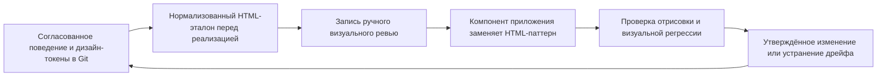

# Передача дизайна в разработку и визуальное ревью

## Источники правды и текущая готовность

Согласно [ADR-0024](../03-ADR/ADR-0024-git-design-reference-workflow.md), ревью дизайна ориентировано на локальную работу и версионируется прямо в Git. [Историческая передача через Figma](Figma-Handoff.md) устарела и носит лишь справочный характер; использование Figma необязательно. Машинные дизайн-токены определяются архитектурным решением [ADR-0014](../03-ADR/ADR-0014-git-design-tokens.md).

| Область | Канонический источник | Текущая готовность |
| --- | --- | --- |
| Бренд, доступность, семантические состояния, правила токенов и компонентов | [Основы дизайна](Design-Foundation.md) | Принятая спецификация; значения бренда и токенов зафиксированы. |
| Информационная архитектура и поведение рабочей области отклика (Application Workspace) | [Application Workspace](Application-Workspace.md) | Ограниченный адаптивный интерфейс на React реализован строго по этому контракту. Отложенные разделы и общая миграция данных пока не реализованы. |
| Машинные значения | [`brand/tokens/cvortex.tokens.json`](../../brand/tokens/cvortex.tokens.json) | Канонический JSON в формате DTCG; значения не менялись при согласовании. |
| Визуальный эталон каждого паттерна | Исполняемый эталон, зафиксированный версией, состоянием и экраном в манифесте | Владелец продукта выбрал концепцию **«Орбита решения»** 10 октября 2026 года; утверждённый синтетический [канонический эталон](reference/README.md) является единственным активным. Предыдущий черновик отправлен в архив. Этап B01 принят по ADR-0025; статус жизненного цикла `reviewed` для базовой визуальной линии. Полные ручные проверки остаются открытыми и блокируют релиз в продакшн. Личный предпросмотр служит лишь подтверждением сценариев. |
| Реализация в коде | Компоненты React, привязанные к каноническому эталону Application Workspace | Реализован порт на React в `apps/frontend/src/app/application/`; [карта компонентов и тесты](validation/application-port-2026-10-11/README.md) фиксируют соответствие компонентов эталону и автоматические проверки. Новой работы с базой данных или расширения доменных функций это не добавляет. |
| Подтверждения визуального расхождения (дрейфа) | Проверенные эталоны и снимки расхождений в зафиксированном окружении | Сравнение React-порта от 11 октября 2026 года охватывает 97 сценариев и 142 пары прокрутки с репрезентативными скриншотами; полный массив снимков хранится локально. Это подтверждение визуального паритета, а не ручная проверка доступности или кроссплатформенности. |

Каждая зона ответственности имеет свой явный источник правды. Конфликты нельзя решать по принципу «кто последний отредактировал макет или скриншот». Правила безопасности, бизнес-логика и машинные токены всегда имеют приоритет над визуальными набросками. При обнаружении расхождения открывается ревью, и правки сначала вносятся в исходный документ, а уже потом утверждаются в качестве нового эталона.

## Жизненный цикл передачи макетов

Для каждого паттерна поддерживается ровно один активный визуальный эталон, указанный в компактном манифесте в папке `docs/07-Design/reference/`. [Манифест этапа B01](reference/manifest.json) связывает черновой HTML-эталон и сгенерированные стили токенов. Манифест служит реестром проверок и указателем путей, а не отдельным источником тем. Не создавайте дублирующие компоненты-клоны только ради поддержания эталона.

Минимальный состав записи:

| Поле | Обязательное содержание |
| --- | --- |
| Паттерн / область | Стабильное имя компонента в PascalCase и ссылка на документ с описанием поведения. |
| Жизненный цикл | `draft`, `reviewed` или `deprecated`; только статус `reviewed` считается утверждённым эталоном. |
| Доступность реализации | Только эталон, уже реализованный компонент или отложенная доменная функция. |
| Активный эталон | Ровно один путь к HTML-файлу или фикстуре компонента с ревизией источника. |
| Источник токенов | Путь к каноническому JSON + хэш ревизии; любые стили CSS должны генерироваться из него явно. |
| Состояния / экран | Идентификатор сценария или фикстуры, размеры экрана, состояния загрузки, пустого экрана, ошибок, устаревания данных, блокировок и ожидания согласования. |
| Условия захвата снимков | Браузер/сборка, ОС/контейнер, версия шрифтов, часовой пояс/локаль, настройки анимации и таймеров. |
| Ревью | Имя проверяющего, дата, итог проверки, пути к скриншотам/диффам и оставшиеся ограничения. Автоматические проверки браузера агентом фиксируются отдельно. |
| Вывод из эксплуатации | Путь и ревизия замены, причина архивации при замене HTML-паттерна на компонент. |

Исторические артефакты сохраняют свои даты и границы проверок. Нельзя утвердить все состояния экрана, посмотрев только на скриншот успешного сценария («happy path»). Если ручная приёмка ещё не проведена, это фиксируется явно, а манифест остаётся со статусом `draft` (за исключением особого регламента приёмки B01 по ADR-0025). Выбор общего визуального направления не заменяет попиксельную приёмку всех состояний.

## Токены и привязка компонентов

Алиасы токенов разрешаются из канонического JSON; до генерации CSS необходимо проверить отсутствие циклических ссылок и поддержку используемых единиц измерения. Сохраняйте единицы `rem` для трекинга шрифтов (`font.tracking`) и прозрачность альфа-каналов. Всегда сверяйте полученный CSS с каноническими значениями и не полагайтесь слепо на комментарии вида `derived from`. В рамках первой задачи настраивается детерминированная генерация стилей для эталона; полная автоматизация тем для продакшна оформляется отдельной обоснованной задачей.

Имена компонентов записываются в PascalCase; пути токенов — строчными буквами через точку; производные имена в CSS — в кебаб-регистре (`kebab-case`). Существующие компоненты `CareerWorkspace`, `VacancyWorkspace` и `ApplicationDraftPanel` сохраняют свои имена в коде; появление новых терминов в дизайн-концепциях не даёт повода для переименования файлов и масштабного рефакторинга. Не подключайте библиотеки примитивов вроде Lucide или Storybook только ради красивой таксономии без явной производственной необходимости.

## Регламент внесения изменений и ревью

1. Определите границы задачи и затрагиваемые состояния, токены или эталоны; выполните предварительную проверку репозитория перед записью.
2. Обновите спецификацию, если меняется логика. Изменения токенов требуют правок канонического JSON и последующего обновления эталонов; нельзя заводить отдельный «ручной» CSS.
3. До начала разработки скорректируйте только затронутый HTML-эталон с помощью синтетических фикстур и значений из токенов. После реализации запустите реальную фикстуру компонента и выведите временный HTML-эталон из эксплуатации.
4. Сделайте снимки обычных и граничных состояний в строго зафиксированном окружении. Проверьте десктопную и мобильную вёрстку, масштабирование 200%, длинные тексты, отсутствие подтверждений фактов, ошибки и состояния согласования.
5. Разделяйте автоматические тесты и ручную визуальную проверку доступности. Всегда просматривайте диффы перед обновлением эталонных снимков; никогда не одобряйте изменения вслепую через флаг `--update-snapshots` и не маскируйте проблемы фокуса или отсутствие источников данных.
6. Обновите карту компонентов, документацию и файлы состояния задач, после чего завершите ограниченный блок работ. Публикация и доставка изменений по-прежнему требуют явного подтверждения пользователя и соблюдения правил Git.

При откате изменений возвращаются к предыдущей согласованной версии спецификации, токенов и эталонов вместе со снимками. Никаких миграций базы данных или бэкенда для чисто визуальных изменений не требуется.

## Требования к валидации будущих реализаций

При изменении кода фронтенда сначала запускаются точечные проверки компонентов и взаимодействий, затем линтер ESLint, проверка типов TypeScript, тесты Vitest и сборка проекта. Локальное сравнение скриншотов в Playwright и автоматические тесты доступности подключаются только в рамках специально выделенной задачи на настройку инструментария. Использование внешних платных сервисов для визуального регресса не требуется.

Проверки отрисовки включают: поведение на мобильных и десктопных экранах, перестроение блоков (reflow), честное увеличение страницы до 200%, контрастность выделенных элементов, фокуса и ошибок, отключение анимаций (reduced motion), управление с клавиатуры и возврат фокуса, чтение экранным диктором, обработку устаревшего асинхронного выбора, шлюзы подтверждения фактов и отсутствие внешних сетевых запросов при предпросмотре синтетических фикстур. Используйте фиксированные фикстуры и заморозку таймеров для предсказуемости временных меток. Различия платформ должны учитываться явно, а не сглаживаться завышением порогов допустимых расхождений.

В официальной документации Playwright детально описаны [особенности рендеринга в разных окружениях](https://playwright.dev/docs/test-snapshots) и [границы возможностей автоматических тестов доступности](https://playwright.dev/docs/accessibility-testing). Эти материалы служат ориентиром для работы, но в рамках текущей задачи новый стенд для axe или скриншотных тестов не разворачивался.

## Первый ограниченный этап

Для задачи [Application Workspace reference foundation](../../.agents/tasks/application-workspace-reference-foundation.md) подготовлен локальный эталон на основе токенов и манифест состояний: см. [инструкции по запуску и артефактам проверок](reference/README.md). 10 октября 2026 года владелец выбрал концепцию «Орбита решения» в качестве единственного канонического эталона; синтетические исходники перенесены в `reference/`, а предыдущий черновик заархивирован с контрольными суммами. [Решение владельца и оставшаяся матрица ревью](reference/REVIEW.md) чётко разделяют выбор общего направления и попиксельную приёмку всех состояний, экранов и доступности. Свежие подтверждения приёмки сохранены в `reference/validation/closure-2026-10-10-v1/`. На тот исторический момент этап B01 находился в состоянии ЧАСТИЧНО / ожидает ревью, а этап B02 требовал отдельного согласования; последующее решение по ADR-0025 и отчёты о реализации отменяют этот промежуточный статус. Персональный предпросмотр не является каноническим эталоном. [План согласования концепции B](Concept-B-Reconciliation.md#дорожная-карта-фронтенда) остаётся ориентиром при наличии явного согласования.

## Итог согласования этапа B01 — 11 октября 2026 г.

В соответствии с принятым решением [ADR-0025](../03-ADR/ADR-0025-b01-reference-acceptance-release-gate.md), этап B01 **ПРИНЯТ** в качестве утверждённой владельцем базовой линии визуализации и продуктовой реализации; статус жизненного цикла переведён в `reviewed`. Предыдущие отметки ЧАСТИЧНО / черновик / СТОП являются историческими. Невыполненные ручные проверки остаются в статусе **НЕ ПРОВЕРЕНО**, а обязательная контрольная задача `.agents/tasks/b01-manual-accessibility-release-gate.md` блокирует релиз в продакшн. Этап B02 явно разрешён к выполнению после завершения B01; этап B03 не согласован.

## Приёмка владельцем реализации на React — 11 октября 2026 г.

Владелец продукта утверждает визуальное направление «Орбита решения» и его реализацию на React с точки зрения соответствия каноническому эталону, адаптивной вёрстки для компьютеров, планшетов и смартфонов, навигации, типографики, компоновки рабочего пространства и визуального языка компонентов. Это не означает, что каждое состояние или размер экрана были проверены лично. Ручное тестирование со скринридером, честное масштабирование до 200%, сквозные E2E-тесты с авторизацией в Laravel и контрольный шлюз доступности перед релизом остаются открытыми (статус: не проверено); требования ADR-0025 сохраняют полную силу.

## Передача результатов этапа B02 — 11 октября 2026 г.

Этап B02 завершён локально: использованы существующие экраны Next.js WorkspaceShell, Career и Diagnostics без создания второго фронтенда или темы оформления. [Отчёт о выполнении](validation/b02-2026-10-11/README.md) фиксирует скриншоты десктопной и мобильной вёрстки на синтетических данных, проверки навигации с клавиатуры, авторизации, ролей и валидацию фронтенда. В рамках этапа реализована только глобальная навигация; это не заменяет полный эталон Application Workspace из B01 и не подтверждает визуальную регрессию или доступность в продакшне. Ручной приёмочный шлюз B01 остаётся ОТКРЫТЫМ; выполнение этапа B03 не авторизовано.
