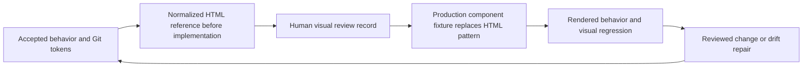

# Git Design Handoff and Visual Review

## Authority and current readiness

Under [ADR-0024](../03-ADR/ADR-0024-git-design-reference-workflow.md), design review is local-first and versioned in Git. [Figma Handoff](Figma-Handoff.md) is historical/superseded; Figma is optional. [ADR-0014](../03-ADR/ADR-0014-git-design-tokens.md) remains the machine-token decision.

| Concern | Canonical source | Present readiness |
| --- | --- | --- |
| Brand, accessibility, semantic states, token/component conventions | [Design Foundation](Design-Foundation.md) | Accepted specification; brand/token values retained. |
| IA / Application Workspace behavior | [Application Workspace](Application-Workspace.md) | The bounded responsive React surface is implemented against this contract. Deferred destinations and the broader domain/persistence migration remain unimplemented. |
| Machine values | [`brand/tokens/cvortex.tokens.json`](../../brand/tokens/cvortex.tokens.json) | Existing canonical DTCG JSON; no values changed by reconciliation. |
| Visual reference per pattern | Reviewed executable reference identified by manifest revision/state/viewport | Owner selected **«Орбита решения»** on 2026-10-10; promoted synthetic [canonical reference](reference/README.md) is the only active mapping. Previous draft is archived. B01 ACCEPTED under ADR-0025; lifecycle `reviewed` for owner visual/product baseline. Full manual checks remain open and block production release. Personal preview is scenario evidence only. |
| Implemented presentation | React components mapped to the canonical Application Workspace reference | The bounded React port is implemented in `apps/frontend/src/app/application/`; [component mapping and validation](validation/application-port-2026-10-11/README.md) record the source-to-component correspondence and automated evidence. It does not add persistence or new domain capability. |
| Visual drift evidence | Reviewed baselines + actual/diff capture in a pinned environment | The 2026-10-11 React port comparison records 97 cases and 142 scroll pairs with representative evidence; the full capture corpus remains local-only. This is scoped parity evidence, not manual accessibility or cross-platform validation. |

Different concerns have explicit authorities; conflicts do not resolve by whichever canvas or screenshot was edited last. Behavioral/security rules and machine tokens constrain visual references. A discrepancy opens a review, and the intended change is recorded in the relevant source before baseline approval.

## Handoff lifecycle

Keep one active visual reference per pattern, identified by a small manifest under `docs/07-Design/reference/`. B01's [manifest](reference/manifest.json) locates its draft HTML reference and generated token CSS. The manifest is a locator/review record, not another token/theme source. Do not create an independent production component clone for reference maintenance.

Minimum record:

| Field | Required content |
| --- | --- |
| Pattern / scope | Stable PascalCase component/pattern name and behavior-document anchor. |
| Lifecycle | `draft`, `reviewed` or `deprecated`; only `reviewed` is a visual baseline. |
| Implementation availability | Reference-only, existing implementation, or deferred domain capability. |
| Active reference | Exactly one HTML or production fixture path, with source revision. |
| Token authority | Canonical JSON path + revision/hash; any generated CSS is explicitly derived. |
| States / viewport | Explicit scenario/fixture ID, layout dimensions, loading/empty/error/stale/blocked/approval cases. |
| Capture conditions | Browser/build, OS/container, font source/version, timezone/locale, motion/clock settings. |
| Review | Named human reviewer, date, outcome, screenshot/diff paths and unresolved limitations. Agent browser checks are recorded separately. |
| Retirement | Replacement path/revision and reason when HTML is replaced or a pattern deprecated. |

Historical artifacts retain their dates and evidence boundaries. A reviewer cannot approve all states by viewing only the happy-path screenshot. If human review is pending, record it; the manifest remains `draft`, except the explicit B01-only ADR-0025 acceptance/release-gate process. Direction selection does not stand in for pixel/state acceptance.

## Tokens and component mapping

Resolve aliases from the canonical JSON; validate missing/cyclic references and supported token types/units before CSS derivation. Preserve `font.tracking` rem units and alpha compositing. Compare the production subset against canonical values; do not trust its `derived from` comment as an executable guarantee. The first task scopes a deterministic reference derivation; production theme automation is a separate justified change.

Component names use PascalCase nouns; tokens use lowercase dot paths; CSS derivations use consistent kebab-case names. Existing `CareerWorkspace`, `VacancyWorkspace` and `ApplicationDraftPanel` remain actual implementation names; taxonomy candidates do not authorize file renames/refactors. Do not introduce a primitive library or install Lucide/Storybook on the strength of a taxonomy alone.

## Change and review procedure

1. Identify the bounded change and affected behavior/token/reference states; run the repository write preflight.
2. Update the accepted specification when intent changes. Token changes require canonical JSON review and downstream reference refresh; no independent CSS master.
3. Before implementation, normalize only the affected HTML reference with synthetic fixtures and token-derived values. After implementation, exercise the actual component fixture and retire its HTML counterpart.
4. Capture normal and edge states with pinned inputs and environment. Review desktop/mobile/zoom, long text, missing evidence and failure/approval states.
5. Record automatic checks and human visual/accessibility review separately. Inspect intended diffs before accepting a new golden baseline; never auto-approve by `--update-snapshots` or mask blockers/focus/provenance.
6. Update mapping, docs and state, then stop at the bounded task. Delivery/publication still follows explicit user authorization and Git policy.

Rollback restores the previous versioned specification/token/reference mapping and reviewed baseline together where affected. No backend/API/schema migration is implied.

## Validation contract for future implementation

Use the narrowest meaningful component/interaction checks first, then frontend ESLint, TypeScript, Vitest and production build when frontend code changes. Add local Playwright screenshot comparisons and targeted automated accessibility checks only in the separately authorized tooling task; select/pin compatible packages then. No hosted visual service is required.

Rendered checks include desktop/mobile/reflow, real 200% zoom, contrast of selected/focus/error states, reduced motion, keyboard/return-focus, manual screen-reader reading/announcements, async stale-selection handling, provenance/approval gates and no external requests from synthetic fixture previews. Use fixtures/clock settings to make timestamps deterministic; don't hide content whose correctness matters. Baseline platform differences are explicit rather than tuned away with a broad diff tolerance.

[Playwright documents environment-dependent rendering](https://playwright.dev/docs/test-snapshots) and [the limits of automated accessibility testing](https://playwright.dev/docs/accessibility-testing). These support the workflow; this task has not installed/run a new visual regression or axe harness.

## First bounded task

[Application Workspace reference foundation](../../.agents/tasks/application-workspace-reference-foundation.md) has a token-derived, reviewable local reference and state manifest: [run/evidence instructions](reference/README.md). Owner selected «Орбита решения» as the sole canonical reference on 2026-10-10; synthetic candidate sources were promoted into `reference/` and the previous draft was archived with hashes. The [owner decision and remaining review matrix](reference/REVIEW.md) distinguish direction approval from state/viewport/accessibility acceptance. Fresh closure evidence is versioned under `reference/validation/closure-2026-10-10-v1/`. At that historical checkpoint B01 was PARTIAL / awaiting-review and B02 still required separate authorization; the later ADR-0025 decision and implementation records below supersede that state. Personal preview is not a canonical reference. [Reconciliation roadmap](Concept-B-Reconciliation.md#bounded-frontend-roadmap) remains conditional.

## Current B01 governance outcome — 2026-10-11

Under accepted [ADR-0025](../03-ADR/ADR-0025-b01-reference-acceptance-release-gate.md), B01 is **ACCEPTED** as the owner-approved visual/product implementation baseline; lifecycle `reviewed`. Earlier PARTIAL/draft/STOP records above are historical. Unperformed manual checks remain **NOT TESTED**, with mandatory follow-up `.agents/tasks/b01-manual-accessibility-release-gate.md` blocking production release. B02 is explicitly authorized after this closure; B03 is not authorized.

## Owner acceptance of the React implementation — 2026-10-11

The owner accepts the «Орбита решения» visual direction and its React implementation
for canonical correspondence, desktop/tablet/mobile design, navigation, typography,
workspace composition and component visual language. This is not a claim that every
state or viewport was personally reviewed. Manual screen-reader verification, native
200% zoom, real authenticated Laravel E2E and the production accessibility release
gate remain open/not tested; ADR-0025 remains in force.

## B02 implementation handoff — 2026-10-11

B02 is completed locally: existing Next.js WorkspaceShell/Career/Diagnostics surfaces,
no second frontend/theme. [Execution evidence](validation/b02-2026-10-11/README.md)
records synthetic desktop/mobile screenshots, keyboard/navigation/auth/role checks
and actual frontend validation. It implements only global navigation; it does not
replace B01's complete Application Workspace reference or establish production
visual regression/AT acceptance. B01 manual release gate remains OPEN; B03 not authorized.
